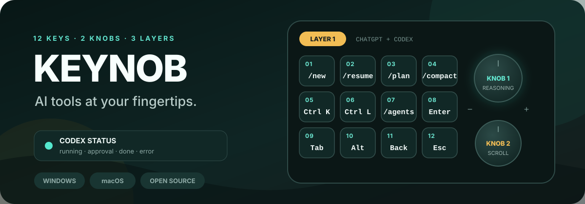
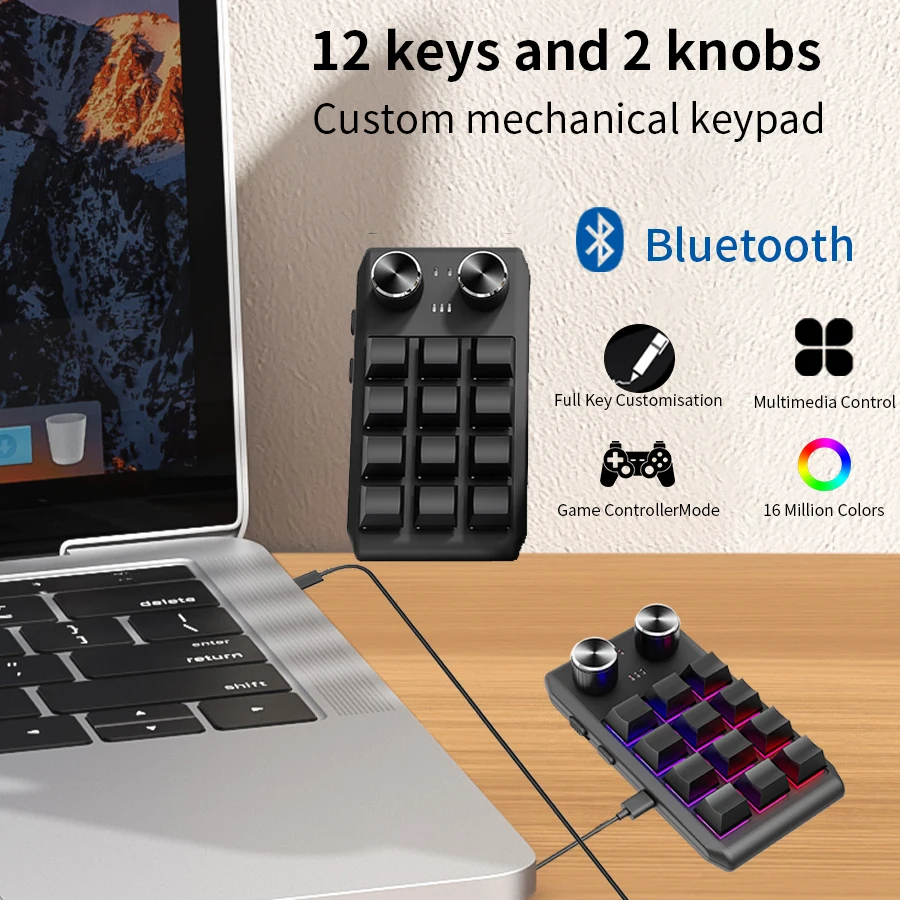
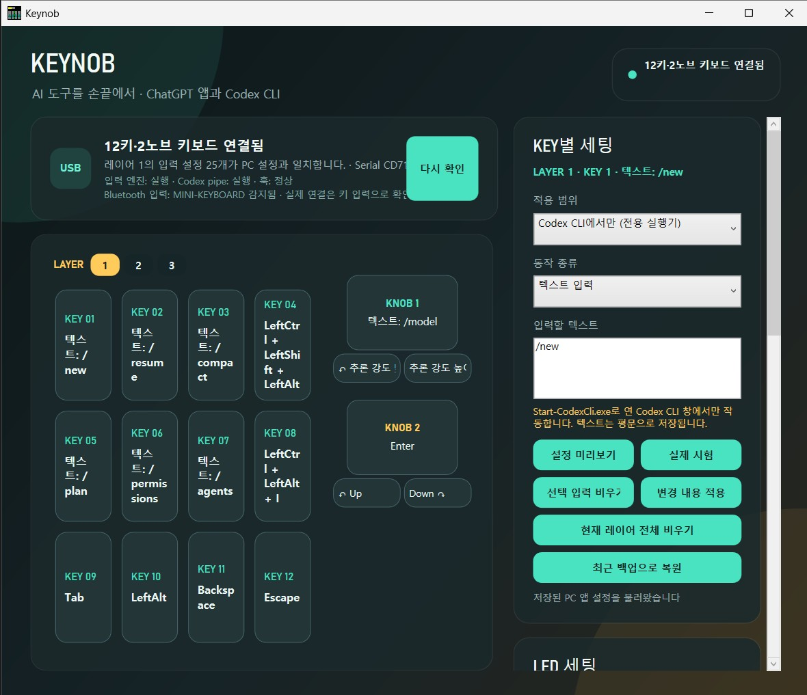
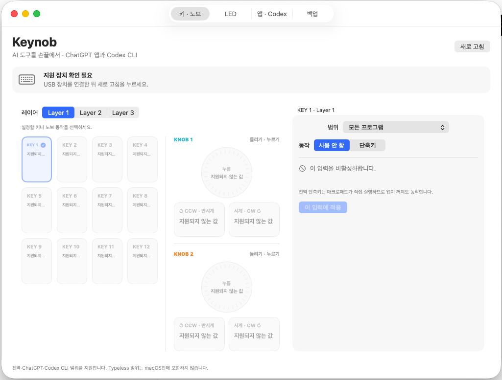

<p align="center">
  
</p>

# Keynob

**12개의 키와 2개의 노브로 ChatGPT와 Codex 작업을 바로 실행하세요.**

Keynob는 호환 매크로패드에 단축키, 텍스트, 앱별 동작과 LED 상태를 설정하는
Windows·macOS 오픈 소스 앱입니다.

[Windows beta.4 다운로드](https://github.com/jhc3516/keynob/releases/tag/v1.0.0-beta.4)
· [macOS 빌드하기](macos/README.md)
· [호환 장치 확인](docs/device-protocol.md)

> [!IMPORTANT]
> 현재 확인된 장치는 **12키·2노브**, VID `514C`, PID `8850` 모델입니다.
> 외형이 같더라도 보고서 구조가 다르면 호환되지 않습니다.

## 사용하는 매크로패드

<p align="center">
  <a href="https://s.click.aliexpress.com/e/_c3EbIGcv">
    
  </a>
  <br>
  <sub>제품 사진: AliExpress 판매 페이지 제공 · 옵션과 구성은 판매 시점에 따라 달라질 수 있습니다.</sub>
</p>

Keynob에서 사용하는 물리 장치는 [이 제품의 12키·2노브 모델](https://s.click.aliexpress.com/e/_c3EbIGcv)입니다.
구매할 때 키와 노브 수를 확인하세요. 판매 옵션이나 내부 펌웨어가 바뀔 수 있으므로 외형만으로 판단하지 말고,
연결 후 VID `514C`·PID `8850`과 [장치 프로토콜](docs/device-protocol.md)을 함께 확인하는 것이 안전합니다.

## 손끝에 놓는 AI 작업

| 하고 싶은 일 | Keynob에서 설정하는 방법 |
| --- | --- |
| 새 Codex 작업 시작 | 키에 `/new` 같은 텍스트 저장 |
| 이전 작업 이어가기 | 키에 `/resume` 저장 |
| 추론 수준 조절 | 노브 회전에 대상 앱의 단축키 연결 |
| 앱마다 다른 키 사용 | `ChatGPT에서만` 또는 `Codex CLI에서만` 범위 선택 |
| 작업 상태 확인 | 실행·승인 대기·완료·오류 상태를 LED로 표시 |

세 레이어에 서로 다른 동작을 저장할 수 있으며, 키 12개와 노브의 반시계 회전·누르기·시계 회전에
각각 단축키나 텍스트를 연결할 수 있습니다.

## 실제 설정 화면



<details>
<summary>macOS 화면 보기</summary>



</details>

## 3단계로 시작하기

1. 호환 매크로패드 한 대를 USB로 연결하고 Keynob를 실행합니다.
2. 장치의 현재 설정을 읽은 뒤 레이어와 키 또는 노브를 선택합니다.
3. 동작을 저장하고 해당 입력이 원하는 앱에 전달되는지 확인합니다.

처음에는 적용 범위를 `모든 프로그램`으로 둔 일반 키 하나를 설정해 연결과 저장을 확인하는 것이 좋습니다.
기존 장치 설정이 중요하다면 변경 전에 별도로 기록하거나 백업해 두세요.

## 지원 환경

| 운영체제 | 제공 형태 | 준비할 것 |
| --- | --- | --- |
| Windows 10/11 x64 | 베타 실행 파일 | ZIP을 내려받아 압축 해제 |
| macOS 13 이상 | 실험판 소스, 로컬 빌드 | Swift 6과 호환되는 Xcode 또는 Command Line Tools |

[위 제품의 12키·2노브 모델](https://s.click.aliexpress.com/e/_c3EbIGcv)과 USB 연결이 필요합니다.
일반 키 입력은 USB 또는 Bluetooth로 사용할 수 있지만, 장치 설정은 USB로 진행합니다.
상세 호환 조건은 [장치 프로토콜](docs/device-protocol.md)을 확인하세요.

macOS의 모든 앱별 동작과 Intel 장치 입력은 아직 실물 검증을 완료하지 않았습니다.
[macOS 검증 범위](macos/README.md#검증-범위)에 확인된 항목과 남은 항목을 구분해 두었습니다.

## 설치하기

### Windows

1. [Keynob beta.4 다운로드 페이지](https://github.com/jhc3516/keynob/releases/tag/v1.0.0-beta.4)에서
   `Keynob-v1.0.0-beta.4-win-x64.zip`을 받습니다.
2. 원하는 폴더에 압축을 모두 풀고 `Keynob.exe`를 실행합니다.
3. 매크로패드를 USB로 연결하고 앱에서 장치가 인식되는지 확인합니다.

베타 실행 파일은 코드 서명되지 않아 Windows에서 게시자 경고가 표시될 수 있습니다.
이전 버전을 사용 중이라면 [업그레이드 안내](docs/upgrading.md)를 확인하세요.

[Windows 상세 안내와 소스 빌드](docs/windows.md)

### macOS

Mac에서는 소스를 받아 앱을 직접 빌드합니다.

```bash
git clone https://github.com/jhc3516/keynob.git
cd keynob
./scripts/build-macos-app.sh
open "artifacts/macos/Keynob.app"
```

앱이 열리면 매크로패드를 USB로 연결하고 `새로 고침`을 누릅니다.
생성된 앱은 로컬 서명이 적용된 빌드이며, 공증된 Mac 실행 파일은 제공하지 않습니다.

[macOS 상세 안내와 빌드 문제 해결](macos/README.md)

## ChatGPT와 Codex CLI에 연결하기

기본 입력을 확인한 뒤 키·노브의 범위를 `ChatGPT에서만` 또는 `Codex CLI에서만`으로 바꾸고
원하는 동작을 저장하세요. 앱별 동작을 사용하려면 Keynob가 실행 중이어야 합니다.

macOS에서는 추가 설정이 필요합니다.

1. `앱 · Codex` 탭에서 `권한 확인 후 시작`을 누르고 Keynob의 손쉬운 사용 권한을 허용합니다.
2. 라우터가 실행 중인지 확인하고 대상 앱의 입력칸에서 테스트합니다.
3. Codex CLI는 Keynob의 전용 실행기로 연 Terminal 창을 사용합니다.

추론 수준 조절 등 일부 동작은 대상 앱에 등록된 단축키에 따라 작동합니다.
지원 범위와 필요한 설정은 [macOS 앱별 동작 안내](macos/README.md#앱별-동작과-권한)를 확인하세요.
Codex CLI 상태를 LED로 표시하는 훅 연동은 선택 기능입니다.
[Windows 상태 연동](docs/windows.md#windows-codex-cli-상태-연동) · [macOS 상태 LED](macos/README.md#codex-상태-led)

## 잘 동작하지 않을 때

- **장치가 보이지 않으면:** USB 연결과 지원 모델을 확인하고, 설정할 장치 한 대만 연결하세요.
- **Mac 앱별 입력이 안 되면:** [입력 전달 진단](macos/README.md#라우터는-실행-중인데-입력되지-않을-때)을 확인하세요.
- **Karabiner-Elements를 함께 쓰면:** [매크로패드 제외 설정](macos/README.md#karabiner-elements-사용-시)을 확인하세요.

소스 구조, 버전 구분, 개발·검증 기록은 [문서 목록](docs/README.md)에서 확인할 수 있습니다.

## 라이선스

Keynob 소스는 [MIT License](LICENSE)로 제공됩니다.
Windows 배포물에 포함된 .NET·WPF·Windows SDK와 HIDAPI의 별도 조건은
[서드파티 고지](THIRD_PARTY_NOTICES.md)를 확인하세요. 원문은 [`licenses/`](licenses/)에 보관합니다.
